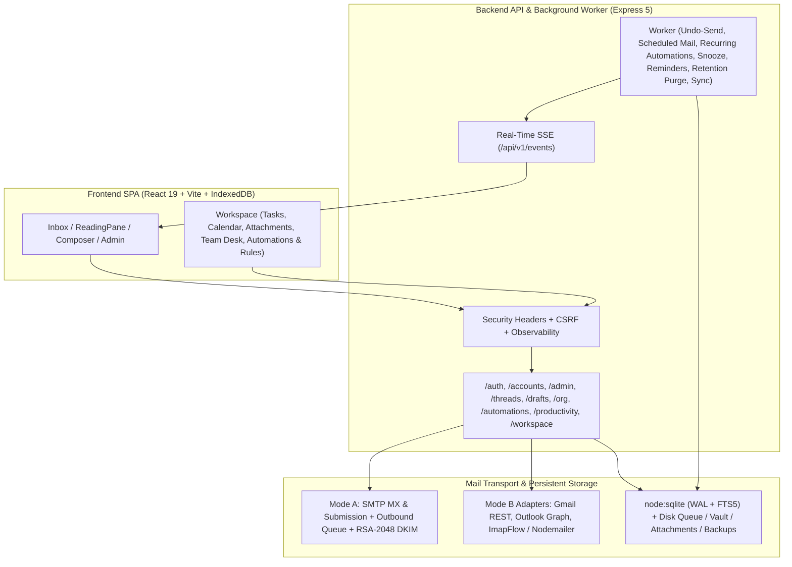

# Cadence — Hybrid Independent & Multi-Provider Email Ecosystem

Cadence is a full-stack, privacy-first email platform built with TypeScript, React 19, Vite, Express 5, and built-in `node:sqlite` (WAL + FTS5 full-text search), with optional single-file Windows desktop packaging (`dist-exe/Cadence.exe`) and Docker deployment.

It operates seamlessly across three integrated modes in one workspace:
- **Mode A — Independent Email Infrastructure**: Host custom domains, mailboxes, aliases, RSA-2048 DKIM signing, incoming SMTP MX listener (`smtp/smtpServer.ts`), authenticated SMTP submission, persistent disk-backed outbound queue/MTA (`mailDeliveryEngine.ts`), live DNS auditor (`domainService.ts`), and verified point-in-time backups (`backupService.ts`).
- **Mode B — Connected External Accounts**: Connect Gmail (OAuth 2.0 + Gmail REST API or App Password IMAP), Outlook / Microsoft 365 (OAuth 2.0 + Microsoft Graph API or IMAP/SMTP), Yahoo Mail, iCloud Mail, Zoho Mail (`.com` / `.in` / `.eu`), Fastmail, or any custom IMAP/SMTP server (via `ImapFlow`, `mailparser`, and `Nodemailer`).
- **Mode C — Unified Workspace, Automations & Productivity**: Multi-account or unified inbox triage, tip-tap rich composer, undo-send & scheduled sending, **Scheduled Recurring Mail (e.g. Daily 5:00 AM + Attachments)**, **Google Maps Location & Shared Info Vault**, keyword/sender **Rules & Auto-Replies**, **Team Desk** shared mailboxes, **Tasks**, **Calendar** (`.ics` import/export & event extraction), **Contacts**, **Attachments Library**, and optional server-side AI intelligence.

---

## 1. System Architecture & Key Security Guarantees



- **Credential Security**: OAuth tokens and IMAP/SMTP passwords are encrypted at rest with **AES-256-GCM** using `CADENCE_ENCRYPTION_KEY` (or an auto-generated 256-bit key at `DATA_DIR/.cadence-master.key`, mode `0600`) and are never returned in API responses or sent to AI providers.
- **Session & Request Hardening**: Salted `scrypt` password hashes, `HttpOnly` `SameSite=Lax` session cookies, per-session `X-CSRF-Token` validation, admin RBAC on infrastructure & server-wide OAuth/AI config endpoints, and rate-limited auth endpoints.
- **Email & Attachment Safety**: Dual-layer HTML sanitization (server `sanitize-html` + client `DOMPurify`), 1x1 tracking-pixel stripping, external images hidden behind `data-blocked-src` until revealed, suspicious link detection, and `Content-Security-Policy: sandbox; default-src 'none'` on attachment downloads.

### Repository Architecture
```text
.
├── .github/workflows/ci.yml   # GitHub Actions CI, Playwright E2E, & Windows EXE release builds
├── client/                    # React 19 + TypeScript + Vite SPA UI
├── server/                    # Express 5 + node:sqlite (FTS5) + SMTP MX/Submission + Automations + tests
├── scripts/                   # Local dev runner, Playwright harness, & Node SEA Cadence.exe packager
├── tests/                     # Cross-platform Chromium Playwright E2E test suite
├── Dockerfile                 # Multi-stage production container (HTTP 4280 + SMTP 25/587)
├── docker-compose.yml         # Self-hosted stack with persistent volume
└── README.md                  # Full setup, Mode A/B procedures, automations & troubleshooting
```

---

## 2. Quick Start, Environment Files & Windows Desktop EXE

### Run from Source
```bash
npm install --legacy-peer-deps
npm run build
npm run start
```
Open `http://localhost:4280`.

For development with hot-reload (`http://localhost:5173` frontend + `http://localhost:4280` API):
```bash
npm run dev
```

### Build & Run Windows Desktop App (`Cadence.exe`)
```bash
npm run build && npm run build:exe
```
Outputs `dist-exe/Cadence.exe` with embedded frontend assets. Launch `Cadence.exe` directly, or pass optional flags (`--port=4280`, `--data-dir=PATH`, `--no-browser`).

### Docker Deployment
```bash
cp .env.example .env
# Edit .env with CADENCE_ENCRYPTION_KEY, domains, and optional OAuth / relay settings
docker compose up -d --build
curl -f http://localhost:4280/api/v1/health
```

### Environment File Locations & Encryption Key
Secrets can be configured in `.env` or directly via **Connect Real Email -> Configure OAuth2 App / AI API Keys** (Administrator account required; the first workspace user or desktop owner is automatically an admin):
- **Node Server**: `<repo>/.env` (loaded first), then `CADENCE_DATA_DIR/.env` if set.
- **Windows Desktop EXE (`dist-exe/Cadence.exe`)**:
  1. `dist-exe/.env` (alongside `Cadence.exe`, loaded first if keys are unset)
  2. `%LOCALAPPDATA%\CadenceMail\.env` (loaded second; in-app **Save Keys Locally** writes here with `0600` permissions and takes effect immediately without restarting).

Recommended production master key:
```env
CADENCE_ENCRYPTION_KEY=<64-hex-characters-or-strong-passphrase>
```

---

## 3. Procedure A — Create Your Own Independent Email Service (Mode A)

Use this procedure to operate Cadence as its own standalone email server with custom `@yourdomain.com` addresses, DKIM signatures, aliases, and queues without relying on Gmail or Outlook.

### Step 1: Configure `.env` Mail Infrastructure Settings
```env
CADENCE_ADMIN_EMAIL=admin@yourdomain.com
CADENCE_SMTP_ENABLED=true
# Local testing default: 127.0.0.1 | Public server with firewall open: 0.0.0.0
CADENCE_SMTP_BIND=127.0.0.1
CADENCE_SMTP_MX_PORT=2525
CADENCE_SMTP_SUBMISSION_PORT=2587
CADENCE_OUTBOUND_MX_PORT=25
CADENCE_PUBLIC_HOSTNAME=mail.yourdomain.com
# Optional primary domain & STARTTLS certificates:
# CADENCE_PRIMARY_DOMAIN=yourdomain.com
# CADENCE_TLS_CERT=/etc/cadence/certs/fullchain.pem
# CADENCE_TLS_KEY=/etc/cadence/certs/privkey.pem
# Optional outbound smart-host relay if your ISP or VPS blocks outbound TCP port 25:
# CADENCE_RELAY_HOST=
# CADENCE_RELAY_PORT=587
# CADENCE_RELAY_SECURE=false
# CADENCE_RELAY_USER=
# CADENCE_RELAY_PASS=
```

### Step 2: Public Internet Server Networking & DNS (Skip for Local/Private Testing)
For sending/receiving on the public internet from a VPS / cloud server:
1. Open firewall ports **TCP 25** (incoming/outgoing MX), **TCP 587** (authenticated SMTP submission), and **TCP 443** (HTTPS reverse proxy like Caddy or Nginx forwarding to `127.0.0.1:4280`).
2. Configure **Reverse DNS (PTR)** in your VPS provider panel pointing your public IPv4 to `mail.yourdomain.com`.
3. Add the **DNS records** shown inside Cadence (**Administration -> Domains & DNS**):
   - **Ownership `TXT`**: `_cadence-verify.yourdomain.com` -> `cadence-verify=<token>`
   - **`A` Record**: `mail.yourdomain.com` -> `<YOUR_PUBLIC_IPV4>`
   - **`MX` Record**: `yourdomain.com` (priority `10`) -> `mail.yourdomain.com`
   - **SPF `TXT`**: `yourdomain.com` -> `v=spf1 mx a:mail.yourdomain.com ~all`
   - **DKIM `TXT`**: `cadence._domainkey.yourdomain.com` -> `v=DKIM1; k=rsa; p=<generated-public-key>`
   - **DMARC `TXT`**: `_dmarc.yourdomain.com` -> `v=DMARC1; p=quarantine; rua=mailto:postmaster@yourdomain.com`

### Step 3: Register Domain, Provision Mailboxes & Aliases
1. Sign in as the Admin account and open **Administration -> Domains & DNS**.
2. Add `yourdomain.com` -> either publish the DNS records above and click **Verify DNS**, OR check **Activate immediately as an Internal/Private domain** for local/LAN testing.
3. Create email addresses under **Connect Real Email -> Create Own Hosted Email Address** (or **Administration -> Users, Mailboxes & Aliases**).
4. Add forwarding/catch aliases under **Administration -> Users, Mailboxes & Aliases**, inspect outbound retries & SMTP logs under **Mail Queue & Logs**, and create verified snapshots under **Security & Backups**.

> **Local vs Public Note**: Delivery between mailboxes hosted on your Cadence instance works immediately on localhost (`127.0.0.1:2525`). If your residential ISP blocks outbound TCP port `25`, set `CADENCE_RELAY_HOST` / `CADENCE_RELAY_PORT=587` with relay credentials to route outbound mail through a smart host.

---

## 4. Procedure B — Connect Existing External Email Accounts (Mode B)

You can connect multiple personal or work mailboxes side by side and manage all of them from Unified Inbox or per-account views.

### Method 1: Quick IMAP / SMTP Setup (No OAuth App Required)
1. Click **Connect Real Email** in the sidebar (or onboarding screen).
2. Pick a provider preset — or type your email address to auto-detect Gmail, Outlook, Yahoo, iCloud, Zoho (`.com` / `.in` / `.eu`), or Fastmail.
3. Click **Test Connection** to verify both IMAP receive login and SMTP send login, then click **Connect & Sync Real Mail**.

| Provider | IMAP Server / Port | SMTP Server / Port | Password Requirement |
|---|---|---|---|
| **Gmail** | `imap.gmail.com:993` (SSL/TLS) | `smtp.gmail.com:465` (SSL/TLS) | Enable IMAP + 16-char Google App Password (`myaccount.google.com/apppasswords`) |
| **Outlook / M365** | `outlook.office365.com:993` (SSL/TLS) | `smtp-mail.outlook.com:587` (STARTTLS) | OAuth 2.0 recommended (or Microsoft App Password where enabled) |
| **Yahoo Mail** | `imap.mail.yahoo.com:993` (SSL/TLS) | `smtp.mail.yahoo.com:465` (SSL/TLS) | Yahoo App Password generated under Account Security |
| **iCloud Mail** | `imap.mail.me.com:993` (SSL/TLS) | `smtp.mail.me.com:587` (STARTTLS) | App-specific password generated at `appleid.apple.com` |
| **Zoho Mail** | `imap.zoho.com:993` (SSL/TLS) | `smtp.zoho.com:465` (SSL/TLS) | Zoho App Password (`.in` and `.eu` hosts auto-switch when detected) |
| **Fastmail** | `imap.fastmail.com:993` (SSL/TLS) | `smtp.fastmail.com:465` (SSL/TLS) | Fastmail App Password with Mail + SMTP scope |
| **Custom / Bridge** | Organization IMAP host/port | Organization SMTP host/port | Standard credentials (works with company mail servers & Proton Mail Bridge) |

**Rotating Expired Passwords Without Losing History**: Open **Settings -> Accounts & Security** and click **Update Credentials** (or **Reconnect / Update Password**) on that mailbox card. Cadence tests the updated credentials first, re-encrypts them cleanly, and preserves your local labels, rules, and sync history.

### Method 2: Official OAuth 2.0 Sign-In (Gmail REST API & Microsoft Graph)
Admins can save OAuth Client IDs/Secrets either in `.env` or inside **Connect Real Email -> Configure OAuth2 App / AI API Keys** (which shows copyable Callback URLs and Clear buttons).

#### Server vs Windows Desktop EXE Redirect URIs
- **Node Web Server (`PORT=4280`)**:
  - Gmail: `http://localhost:4280/api/v1/accounts/oauth/gmail/callback`
  - Outlook: `http://localhost:4280/api/v1/accounts/oauth/outlook/callback`
- **Windows Desktop EXE (`dist-exe/Cadence.exe`)**:
  - Binds `127.0.0.1:4280` (or an ephemeral free port if `4280` is busy) at launch, serving callbacks on `http://127.0.0.1:<port>/api/v1/accounts/oauth/...`.
  - Copy the live Callback URL from **Configure OAuth2 App / AI API Keys**, or pin port `4280` in `dist-exe/.env` with `PORT=4280` and `CADENCE_EXPLICIT_PORT=1`.
- **Production HTTPS Server**: Set `PUBLIC_URL=https://mail.yourdomain.com`, `CLIENT_ORIGIN=https://mail.yourdomain.com`, and update Redirect URIs accordingly.

#### Gmail OAuth 2.0 Steps
1. Open [Google Cloud Console](https://console.cloud.google.com/) -> enable **Gmail API** (and optionally **People API** for contact sync).
2. Configure OAuth consent screen scopes:
   - `https://www.googleapis.com/auth/gmail.modify`
   - `https://www.googleapis.com/auth/gmail.send`
   - `https://www.googleapis.com/auth/userinfo.email`
   - `https://www.googleapis.com/auth/userinfo.profile`
   - *(Optional Calendar scope)* `https://www.googleapis.com/auth/calendar.readonly`
3. Create a **Web application** OAuth Client ID with your Gmail Callback URI above, then set `GOOGLE_CLIENT_ID`, `GOOGLE_CLIENT_SECRET`, and optionally `GOOGLE_REDIRECT_URI`.

#### Microsoft 365 / Outlook OAuth 2.0 Steps
1. Open [Microsoft Entra Admin Center](https://entra.microsoft.com/) -> **App registrations** -> **New registration**.
2. Add your Web Redirect URI (`.../api/v1/accounts/oauth/outlook/callback`).
3. Under **API permissions**, add delegated Graph permissions: `User.Read`, `Mail.ReadWrite`, `Mail.Send`, `offline_access` (and optionally `Calendars.Read`).
4. Create a client secret and configure `MICROSOFT_CLIENT_ID`, `MICROSOFT_CLIENT_SECRET`, `MICROSOFT_TENANT_ID` (`common` for multi-tenant, or your Directory ID), and optionally `MICROSOFT_REDIRECT_URI`.

> Check **Request optional read-only Calendar OAuth scope** before signing in if desired. Calendar events always run locally with full `.ics` import/export via `/api/v1/workspace/calendar`.

---

## 5. Automations, Scheduled Mail & Google Maps Info Sharing

Open **Rules & Filters** in the sidebar to manage all three automation systems:

1. **Shared Info & Files Vault**
   - Upload reusable files (brochures, PDFs, images, checklists up to `15 MB`) once to attach automatically in rules or scheduled emails.
   - Store **Google Maps Location** cards (enter an address or `lat,lng` coordinates to auto-generate a `https://www.google.com/maps/search/?api=1&query=...` link, or paste a Google Maps share URL) plus Contact / Business Cards and custom snippets (`{{google_map_location}}`, `{{location}}`, `{{contact_info}}`, `{{info:<slug>}}`).
2. **Scheduled & Recurring Mail**
   - Send recurring emails **Daily** (e.g., `05:00` AM), **Weekdays (Mon–Fri)**, **Weekly (custom days)**, **Monthly (Day 1–28)**, or **Every N Hours** in your chosen IANA timezone (`UTC`, `Asia/Kolkata`, etc.).
   - Attach Vault files, pick a Shared Info card, use dynamic placeholders (`{{date}}`, `{{day}}`, `{{time}}`), preview **Next run**, or click **Send Now** for an immediate test send. Use the **Daily 5:00 AM "Hi" + Attachment** quick preset to configure morning check-ins in seconds.
3. **Incoming Mail Rules & Safe Auto-Replies**
   - Use conditions including `contains`, **`contains_any`** (comma-separated keywords such as `location, map, address, directions`), and bounded `regex` across `from`, `to`, `subject`, `body`, `keywords`, `domain`, `category`, and flags.
   - Actions support **`auto_reply`**, **`generate_draft`**, and **`forward`** with Vault file attachments, Info Cards (clickable Google Maps links), custom subjects, and optional original-attachment forwarding — protected by RFC 3834 loop guards (`Auto-Submitted`, `Precedence: bulk|list`, `List-Unsubscribe`, self-sender block, and 30/hr rate caps).

---

## 6. Optional AI Email Intelligence

Set one server-side key in `.env` or via **Connect Real Email -> Configure OAuth2 App / AI API Keys**:

```env
# Priority 1: Google Gemini
GEMINI_API_KEY=your-gemini-api-key
GEMINI_MODEL=gemini-2.5-flash

# Priority 2: OpenAI (or compatible API gateway / local LLM endpoint)
OPENAI_API_KEY=your-openai-api-key
OPENAI_MODEL=gpt-4o-mini
OPENAI_BASE_URL=https://api.openai.com/v1

# Priority 3: Anthropic Claude
ANTHROPIC_API_KEY=your-anthropic-api-key
ANTHROPIC_MODEL=claude-3-5-haiku-latest
```
Active provider priority is `Gemini -> OpenAI -> Anthropic`. AI features stay disabled until explicitly enabled in **Settings -> AI & Privacy**, strip sensitive patterns (cards, SSNs, API keys, passwords) when redaction is checked, and require user confirmation before executing multi-step workflow plans.

---

## 7. Verification, Tests & Troubleshooting

### Run Automated Checks
```bash
npm run typecheck                             # Server & client TypeScript verification
npx tsx --test server/tests/backend.test.ts   # Backend security, Mode A SMTP/DKIM, RBAC, and automation suite tests
npm run test:e2e                              # Headless Chromium Playwright E2E against web production build
npm run test:exe                              # Headless Chromium Playwright E2E against dist-exe/Cadence.exe
```

### Common Troubleshooting
- **IMAP/SMTP `535` Authentication Failed**: Generate an **App Password** from your email provider when 2FA is enabled, and confirm IMAP access is enabled in webmail settings.
- **OAuth `redirect_uri_mismatch` on `Cadence.exe`**: Copy the live `http://127.0.0.1:<port>/...` callback shown in **Configure OAuth2 App / AI API Keys** into Google Cloud / Microsoft Entra, or pin port `4280` with `PORT=4280` + `CADENCE_EXPLICIT_PORT=1` in `dist-exe/.env`.
- **Mode A Outbound Blocked on Port `25`**: Residential ISPs and some VPS hosts block port `25` egress; configure `CADENCE_RELAY_HOST` (`587`) in `.env`.
- **"Administrator privileges required" on OAuth/AI Config**: Server-wide `.env` keys can only be modified by an admin account; regular members can still connect their own personal IMAP/SMTP or configured OAuth accounts.
